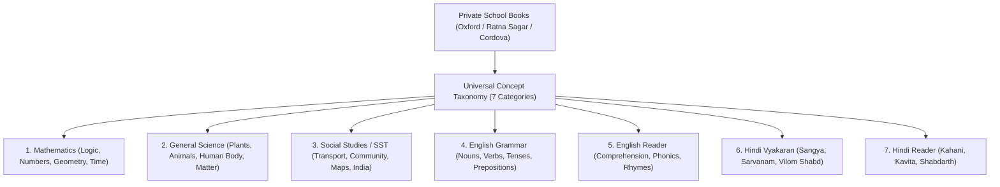
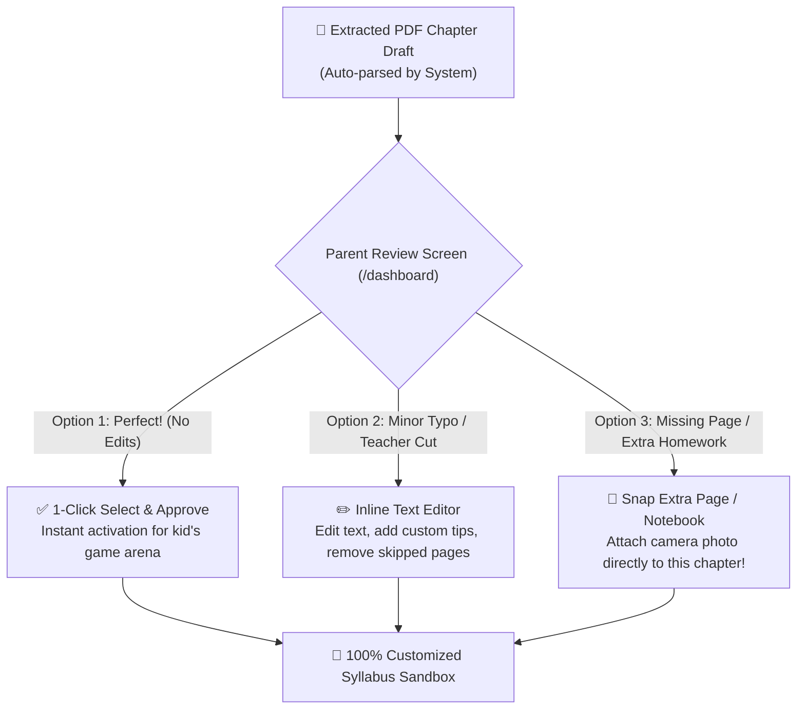
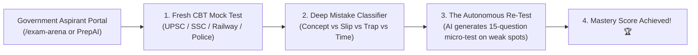

# 📘 KidAI & PrepAI: Master Architecture & Implementation Blueprint
> **AI-Powered Universal Textbook-to-Game Engine & Autonomous Govt Exam Simulator**  
> *Author: Antigravity Team & KidAI Studio Architecture*  
> *Version: 2.0 | Status: Approved Roadmap & Technical Specification*

---

## 📑 TABLE OF CONTENTS
1. [Core Philosophy: "Image as Single Source of Truth" (Conflict Resolution)](#1-core-philosophy-image-as-single-source-of-truth)
2. [Universal Curriculum & Ingestion Engine (Class 1 to 5)](#2-universal-curriculum--ingestion-engine-class-1-to-5)
3. [Private School Books Mapping (Universal Concept Taxonomy)](#3-private-school-books-mapping-universal-concept-taxonomy)
4. [Database Architecture & Data Storage (Supabase & Cloudinary)](#4-database-architecture--data-storage)
5. [Page-by-Page Codebase Integration (Current App Modifications)](#5-page-by-page-codebase-integration)
6. [Phase 2 Roadmap: AI Govt Exam Simulator & Remedial Re-Test (Testbook Model)](#6-phase-2-roadmap-ai-govt-exam-simulator--remedial-re-test)
7. [Cost, Token Economics & Infrastructure Feasibility](#7-cost-token-economics--infrastructure-feasibility)

---

## 1. CORE PHILOSOPHY: "IMAGE AS SINGLE SOURCE OF TRUTH"

### 🎯 The Conflict Problem
Jab bachha kisi bhi school book ke page ki photo kheenchna shuru karta hai, toh **hamare database ke text aur image me printed text me conflict (difference)** ho sakta hai:
* **Example:** Bachhe ki private book me likha hai: *"Rohan has 4 blue balloons and 2 red balloons. How many total?"*
* Lekin NCERT book me likha tha: *"Raju has 5 mangoes and 3 apples."*

### 👑 The Golden Rule: "Image is King" (Ground Truth)
```
┌─────────────────────────────────────────────────────────────┐
│                    SCANNED IMAGE PHOTO                      │
│                ★ PRIMARY SOURCE OF TRUTH ★                  │
│   (Exact characters, questions, numbers, and story context) │
└──────────────────────────────┬──────────────────────────────┘
                               │
                               ▼
┌─────────────────────────────────────────────────────────────┐
│              INTERNAL NCERT / TAXONOMY DATABASE             │
│            ★ SECONDARY PEDAGOGICAL INTELLIGENCE ★           │
│   (Topic anchor, grade-level difficulty, learning pedagogy) │
└──────────────────────────────┬──────────────────────────────┘
                               │
                               ▼
┌─────────────────────────────────────────────────────────────┐
│                 FINAL AI-GENERATED GAME                     │
│  Uses: "Rohan & Balloons" (From Image)                      │
│  With: "Class 1 Addition Logic" (From Pedagogical Anchor)   │
└─────────────────────────────────────────────────────────────┘
```

1. **Content Rule:** Game ka character, story, questions aur numbers **hamesha 100% image se hi aayenge**. Internal database se image ka data kabhi overwrite nahi hoga!
2. **Intelligence Rule:** Hamara internal database sirf **AI ko guide karne (pedagogy)** ke liye use hoga:
   * Is bachhe ki class aur age level kya hai?
   * Is concept ko sikhane ka best educational game mechanic kya hai (Sorting, Matching, Counting, Puzzle)?
   * Bloom's Taxonomy ke hisaab se difficulty level kitna hona chahiye?

---

## 2. UNIVERSAL CURRICULUM & INGESTION ENGINE (CLASS 1 TO 5)

### 📚 Official NCERT Structure (Under NEP 2020)
Government ke official framework me Class 1 se 5 tak **sirf 3 se 4 core subjects** hi hote hain:

| Grade | Official Subjects | Core NCERT Books (English / Hindi) | Ingestion Strategy |
| :--- | :--- | :--- | :--- |
| **Class 1** | English, Hindi, Mathematics (3 Subjects) | *Mridang / Sarangi / Joyful Mathematics* | Core Phonics, Basic Counting, Shapes |
| **Class 2** | English, Hindi, Mathematics (3 Subjects) | *Mridang / Sarangi / Joyful Mathematics* | Basic Sentences, 2-Digit Math, Measurement |
| **Class 3** | English, Hindi, Mathematics, EVS (4 Subjects) | *Santoor / Veena / Maths Mela / Our Wondrous World* | Integrated Science + Society introduction |
| **Class 4** | English, Hindi, Mathematics, EVS (4 Subjects) | *Marigold / Rimjhim / Math-Magic / Looking Around* | Plant/Animal life, Community helpers, Fractions |
| **Class 5** | English, Hindi, Mathematics, EVS (4 Subjects) | *Marigold / Rimjhim / Math-Magic / Looking Around* | Solar system, Maps, Decimals, Heritage |

* **Total Baseline Books:** ~18 core books (Hindi medium editions mila kar ~30-35 PDFs).
* **Pure Text Size:** Sirf **15 MB se 25 MB** JSON (Ultra-lightweight!).

---

## 3. PRIVATE SCHOOL BOOKS MAPPING (UNIVERSAL CONCEPT TAXONOMY)

Private schools (Oxford, Ratna Sagar, Cordova, Viva, Madhubun) alag-alag books banate hain (English Grammar alag, Science alag, SST alag). Inhe hamara system **7 Universal Categories** me map karega:



### 🧠 Semantic Mapping Algorithm:
Jab image aati hai:
1. **Vision Header Scanner:** Image ke top title ko detect karta hai (e.g., *"Proper Nouns vs Common Nouns"* ya *"Parts of a Flower"*).
2. **Concept Matcher:** Universal Concept Taxonomy me check karta hai.
3. **Prompt Enrichment:** AI prompt me category inject karta hai:
   ```json
   {
     "detected_subject": "English Grammar",
     "detected_topic": "Nouns - Proper vs Common",
     "grade_level": 3,
     "game_archetype": "Basket Sorting / Balloon Pop"
   }
   ```

---

## 4. DATABASE ARCHITECTURE & DATA STORAGE

### 🗄️ Supabase PostgreSQL Schema

```sql
-- 1. Books Table (Master Catalog)
CREATE TABLE curriculum_books (
  id UUID PRIMARY KEY DEFAULT gen_random_uuid(),
  class_level INT NOT NULL, -- 1 to 5
  subject_category VARCHAR(50) NOT NULL, -- 'math', 'science', 'sst', 'grammar_en', 'grammar_hi', 'reader_en', 'reader_hi'
  book_title VARCHAR(150) NOT NULL,
  publisher VARCHAR(100) DEFAULT 'NCERT',
  pdf_url TEXT,
  created_at TIMESTAMPTZ DEFAULT NOW()
);

-- 2. Chapters Table (Hierarchy)
CREATE TABLE curriculum_chapters (
  id UUID PRIMARY KEY DEFAULT gen_random_uuid(),
  book_id UUID REFERENCES curriculum_books(id) ON DELETE CASCADE,
  chapter_no INT NOT NULL,
  chapter_title VARCHAR(200) NOT NULL,
  learning_objectives TEXT[],
  created_at TIMESTAMPTZ DEFAULT NOW()
);

-- 3. Pedagogy & Topic Anchors Table (Used for Fast Semantic Lookups)
CREATE TABLE curriculum_topic_anchors (
  id UUID PRIMARY KEY DEFAULT gen_random_uuid(),
  chapter_id UUID REFERENCES curriculum_chapters(id) ON DELETE CASCADE,
  topic_name VARCHAR(150) NOT NULL,
  keywords TEXT[] NOT NULL, -- e.g. ['noun', 'proper noun', 'capital letter', 'naming words']
  recommended_game_type VARCHAR(50) NOT NULL, -- 'drag_and_drop', 'quiz_battle', 'sorting', 'runner'
  age_appropriate_rules JSONB DEFAULT '{}',
  created_at TIMESTAMPTZ DEFAULT NOW()
);

-- Fast Keyword Inverted Index
CREATE INDEX idx_curriculum_keywords ON curriculum_topic_anchors USING GIN(keywords);
```

### ☁️ File Storage Allocation:
* **Cloudinary / Supabase Storage:**
  * Raw Chapter PDFs (~800 MB total for Classes 1-5).
  * High-res illustration assets and game sprites.
* **Database (Supabase):**
  * Structured chapters, keywords, and learning objectives (~20 MB JSON).

---

## 5. PAGE-BY-PAGE CODEBASE INTEGRATION

Current codebase me ye 4 main files upgrade hongi:

### 1. `app/api/ai/scan/route.js` (The Brain)
* **Current State:** Image leta hai aur generic quiz/game JSON banata hai.
* **Upgrade Plan:**
  1. Image aane par sabse pehle **OCR text aur headings** extract karega.
  2. Supabase me `curriculum_topic_anchors` me keywords match karega.
  3. Agar match mila, toh us topic ka **Pedagogical Anchor (Game Type + Grade Objectives)** prompt me include karega.
  4. **Conflict Guard:** System prompt me strictly mandate karega: *"Generate the game strictly from the facts, names, and numbers found in the image. Use the curriculum anchor ONLY to structure the game mechanics."*

### 2. `app/(child)/scanner/page.js` & `app/studio/magic-scanner/page.js` (The UI)
* **Current State:** Photo upload karne ke baad loader dikhata hai.
* **Upgrade Plan:**
  1. **Instant Detection Badge:** Photo scan hote hi screen par animated badge dikhayega:
     > `🎯 Detected: Class 3 Science • Living vs Non-Living Things (100% Syllabus Aligned)`
  2. **Confidence Indicator:** Batayega ki image ke contents ko kitni accuracy se read kiya gaya hai.
  3. **1-Click Game Launch:** Direct playable mini-game iframe/canvas render karega.

### 3. `lib/ai-handler.js`
* Model parameter me `gpt-4o-mini` default rakhega aur token usage logger me `featureName: "Textbook-to-Game AI Scanner"` pass karega.

---

## 6. INTERACTIVE PARENT & TEACHER CURATOR (HUMAN-IN-THE-LOOP STUDIO)

> **💡 The Parent-in-the-Loop Concept:**  
> Jab system PDF se text nikaal kar chapter banata hai, toh parents/teachers ko ek dedicated interface diya jayega jahan wo extracted text ko **verify, edit ya missing page photo se add** kar sakein.



### 🛠️ 3 Power Capabilities For Parents & Teachers:

#### 1. 1-Click Quick Approval (Sabse Aasan):
* Screen par chapter ka summary aur topics aayenge (jaise *Chapter 3: Heavy vs Light*).
* Agar sab sahi dikh raha hai, parent sirf **"Select Entire Chapter ✅"** dabayega aur wo chapter turant bachhe ke daily quest me active ho jayega.

#### 2. Inline Text Edit & Customization:
* Agar school teacher ne kaha ki *"Page 12 ka paragraph syllabus me nahi aayega"* ya parent ko koi definition aasan Karni hai:
* Parent text par tap karke seedha **edit / delete** kar sakta hai.

#### 3. 📸 Snap Missing Page / Extra School Worksheet:
* Agar PDF me koi page dhundhla tha, ya school ne alag se koi **Printed Worksheet / Homework Assignment** diya hai:
* Parent button dabayega: **"📸 Add Homework Page Photo"** ➔ Phone camera se photo click karega ➔ Wo photo usi chapter ke sath attach ho jayegi!
* AI us custom worksheet se bhi bachhe ke liye game bana dega.

### 🗄️ Database Table for Parent Overrides:
```sql
CREATE TABLE parent_chapter_customizations (
  id UUID PRIMARY KEY DEFAULT gen_random_uuid(),
  student_id UUID NOT NULL,
  chapter_id UUID REFERENCES curriculum_chapters(id),
  custom_text TEXT,
  extra_image_urls TEXT[], -- Array of attached worksheet photos
  is_verified_by_parent BOOLEAN DEFAULT TRUE,
  updated_at TIMESTAMPTZ DEFAULT NOW()
);
```

---

## 7. PHASE 2 ROADMAP: AI GOVT EXAM SIMULATOR & REMEDIAL RE-TEST

> **Goal:** Testbook / Adda247 jaisa massive scale platform build karna, lekin **100% Generative AI & Autonomous Remedial Re-Test** capabilities ke saath.



### A. Dual-Universe Interface Architecture:
* **Junior World (Ages 4–14):** `/home`, `/studio`, `/seekho` (Playful, colorful, Arya buddy).
* **Aspirant World (Ages 16–30+):** `/exam-arena` ya `prep.kidaistudio.com` (Professional dark slate theme, TCS-iON CBT format, timer, negative marking, bilingual Hindi/English switch).

### B. Core Features:
1. **Infinite Non-Repeating Mocks:** Syllabus blueprint se AI har candidate ke liye brand new balanced questions banayega.
2. **Root-Cause Diagnostic Analysis:**
   * *Concept Gap* (Formula nahi pata tha).
   * *Calculation Error* (Subtraction slip).
   * *Trap Option* (Distractor option me phasa).
   * *Time Trap* (3+ minutes wasted).
3. **Autonomous "Remedial Re-Test":**
   * Maan lijiye student ke *Compound Interest* aur *1857 Revolt* ke 6 questions galat hue.
   * AI 2 second me **sirf unhi 2 kamzor topics ka 15-question targeted test** banayega aur practice karwayega.
4. **Govt PDF RAG Pipeline:**
   * Official Notifications, Class 6-12 NCERTs, aur State Gazettes upload honge jisse AI 100% verified authentic questions banaye with book page citations.

---

## 8. COST, TOKEN ECONOMICS & INFRASTRUCTURE FEASIBILITY

### 💰 Unit Cost Breakdown (Using GPT-4o-mini Rates):
* **Input Rate:** $0.15 / 1 Million tokens (~₹12.60)
* **Output Rate:** $0.60 / 1 Million tokens (~₹50.40)

| Action | Avg Input Tokens | Avg Output Tokens | Total Cost (USD) | Total Cost (INR) |
| :--- | :--- | :--- | :--- | :--- |
| **1 Book Photo ➔ Mini-Game** | 1,200 tokens | 600 tokens | $0.00054 | **~₹0.045 (4.5 Paise)** |
| **100-Question CBT Mock Paper** | 3,500 tokens | 2,800 tokens | $0.00220 | **~₹0.185 (18.5 Paise)** |
| **15-Question Remedial Re-Test** | 800 tokens | 500 tokens | $0.00042 | **~₹0.035 (3.5 Paise)** |

### 🚀 Business Viability:
* **Cost Advantage:** Ek student agar mahine me 30 games aur 10 mock tests deta hai, toh total AI kharcha **₹3 se ₹4 per month** aayega.
* **Subscription Potential:** Student ya parent se **₹149/saal ya ₹29/mahina** charge karke **85%+ Gross Profit Margin** generate kiya ja sakta hai!

---

## 🏁 IMPLEMENTATION CHECKLIST

- [x] Conflict Resolution Philosophy documented (Image = Ground Truth).
- [x] Class 1 to 5 NCERT Curriculum mapped (18 Core Books).
- [x] Universal Concept Taxonomy for Private Schools defined (7 Categories).
- [x] Supabase PostgreSQL Schema designed with GIN keyword indexing.
- [x] Human-in-the-Loop Parent/Teacher Curator Studio & Snap-Worksheet feature documented.
- [ ] Phase 1: Implement PDF Ingestion & Keyword Anchor tables in Supabase.
- [ ] Phase 1: Build Parent Curriculum Review & Worksheet Snap UI in `/dashboard`.
- [ ] Phase 1: Update `app/api/ai/scan/route.js` with Image-First Conflict Guard.
- [ ] Phase 2: Create `/exam-arena` dedicated CBT layout for older aspirants.
- [ ] Phase 2: Build Autonomous Remedial Re-Test Generator engine.
